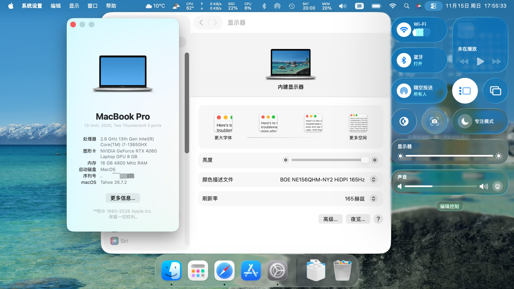

# 猎刃 R15 黑苹果 EFI（ThundeRobot Hunter R15 / HM770 / i7-13650HX / RTX 4060）

OpenCore 引导的 macOS EFI，来自一台雷神猎刃 R15 笔记本（出厂 Windows + 黑苹果双系统）。

**当前版本 v2.0 · 已在 macOS Tahoe 26.7.2 实机验证。**
Wi-Fi、蓝牙 / 隔空投送、RTX 4060 显卡加速与内屏 165Hz HiDPI、亮度 / 音量 / 键盘背光、声卡、有线网、USB、触控板、电池状态、双系统引导均工作正常。
**睡眠 / 唤醒：待验证**（v1.0 时代该链路不可用，本次更新尚未做完整回归，详见「已知问题」）。



> ⚠️ **使用前必读：本 EFI 的三码是占位值**
> `config.plist` 中 `PlatformInfo > Generic` 的 `SystemSerialNumber` / `MLB` / `SystemUUID` 均为 `0`，`ROM` 为空。
> 这是刻意留空以避免公开仓库泄露个人信息，**直接套用会导致 Apple ID / iCloud / iMessage / FaceTime 无法登录，且与他人重复使用同一组三码可能引发账号风险**。
> 首次使用前请用 [GenSMBIOS](https://github.com/corpnewt/GenSMBIOS) 为 `MacBookPro16,2` 生成一组全新的 Serial / MLB / ROM / SystemUUID 并填入 `config.plist`；`ROM` 填 6 字节本机网卡 MAC 地址。之后建议执行一次 ResetNvram。

## 硬件配置

| 组件 | 型号 |
| --- | --- |
| 处理器 | 英特尔第十三代酷睿 i7-13650HX（14 核，Raptor Lake-HX，系统报告 2.8 GHz） |
| 主板 | THUNDEROBOT V350SNX-HL（英特尔 HM770 芯片组） |
| 内存 | 16GB DDR5 4800MHz |
| 显卡 | NVIDIA GeForce RTX 4060 Laptop GPU 8GB（蓝天 / Clevo）——由 NullMoth NVIDIA macOS 驱动启用，作为主显示 GPU，系统直接识别型号 |
| 核显 | 英特尔 UHD（i7-13650HX 集成，当前以 `-wegnoigpu` 屏蔽，显示输出走 RTX 4060） |
| 显示器 | 京东方 BOE NE156QHM-NY2，HiDPI，刷新率 165Hz（系统「显示器」面板实测） |
| 磁盘 | 忆联 YMTC PC300 512GB + 梵想 Fanxiang S500Pro 2TB |
| 声卡 | Realtek High Definition Audio（`SimpleHDA.kext` + `AppleALC` `alcid=11`；另路 NVIDIA HD Audio 已屏蔽） |
| 网卡 | Intel Wi-Fi 6E AX210 160MHz + Realtek PCIe GbE 有线网卡 |
| SMBIOS | `MacBookPro16,2`（MacBook Pro 13-inch, 2020, Four Thunderbolt 3 ports） |

## 功能状态（macOS Tahoe 26.7.2）

| 功能 | 状态 | 依赖 |
| --- | --- | --- |
| 显示输出 / Metal 加速 / HiDPI 165Hz / 亮度调节 | ✅ 正常 | NullMoth NVIDIA 驱动 + WhateverGreen + `nvfbhidpi=1` 等启动参数 |
| Wi-Fi（AX210）、蓝牙、隔空投送 | ✅ 正常 | AirportItlwm（Tahoe 26 对应构建）、IntelBluetoothFirmware / IntelBTPatcher 2.5.1、BlueToolFixup |
| 键盘、触控板、键盘背光、亮度快捷键 | ✅ 正常 | VoodooPS2Controller / VoodooI2C / BrightnessKeys / NMKbdBacklight |
| 声卡、音量控制 | ✅ 正常 | SimpleHDA + AppleALC (`alcid=11`) |
| 有线网、USB 端口定制、电池 / 温度 / 光感 | ✅ 正常 | RealtekRTL8111、SimpleUSBMap、VirtualSMC 系列、ECEnabler |
| Windows / macOS 双系统引导、OpenCanopy 图形菜单 | ✅ 正常 | OpenRuntime / OpenCanopy / HfsPlus / ResetNvramEntry |
| 睡眠 / 唤醒 | ⚠️ 待验证 | 见下文 |

## 目录结构

```
EFI
├── BOOT            # BOOTx64.efi 引导入口
└── OC
    ├── ACPI        # 编译好的 SSDT / 重命名补丁对应的 AML
    ├── Drivers     # OpenRuntime / HfsPlus / OpenCanopy / ResetNvramEntry
    ├── Kexts       # 全部内核扩展（31 项，见 Kernel > Add）
    ├── OpenCore.efi
    ├── config.plist  # OpenCore 主配置
    ├── Resources   # 引导界面资源（图标 / 字体 / 标签，含 GoldenGate Apple26）
    └── Tools       # OpenShell / NullMothSafe.efi
docs/screenshots    # 实机验证截图
```

## 已知问题 / 待验证项

1. **睡眠 / 唤醒：待验证。** v1.0 在当前 BIOS 下 S3 休眠唤醒链路未打通（睡眠后无法唤醒或直接断电）。v2.0 更换了电源管理相关配置与 NVIDIA 启动参数，但本次尚未对睡眠 / 唤醒做完整回归，因此不宣称已修复，也不再列为「确认不可用」。
   排查方向：BIOS 中切换睡眠状态（Modern Standby S0ix ↔ S3）、核对 S3 相关 SSDT、`pmset -g assertions` / `log show --last 1d | grep -i sleep`。
2. 其余功能在 Tahoe 26.7.2 下未发现异常；若在不同 BIOS 版本或屏幕批次上出现问题，请在 Issues 中附上机型信息与 `config.plist` 差异。

## NVIDIA 驱动

RTX 4060 的 macOS 支持来自 NullMoth 开源驱动：<https://github.com/nullmoth/nvidia-macos-driver>
（Metal 驱动，支持 Turing ~ RTX 50 系，驱动文件安装进 `/Library`，**不在本 EFI 内**；版本支持范围以其仓库说明为准，本 EFI 已在 Tahoe 26.7.2 下实测可驱动 RTX 4060 输出）。

本 EFI 已包含该驱动所需的 OpenCore 侧配置：

- `Misc > Security > SecureBootModel = Disabled`
- `csr-active-config = 0xFFF`（SIP 全关）
- `Kernel > Add` 含 `Lilu.kext` 与 `AMFIPass.kext`
- 不含 `nv_disable=1` / `-wegnoegpu`；使用 `-wegnoigpu` 屏蔽核显、保留独显输出
- 完整 `boot-args`：

```
-wegnoigpu alcid=11 nvfb=1 nvaccel=1 nvfbheads=4 -nvkmsnosmooth ipc_control_port_options=0 gfxrst=4 nvrmacpibl=1 itlwm_cc=CN amfi_get_out_of_my_way=0x1 amfi=0x80 revpatch=sbvmm,cpuname nvfbhidpi=1 nvfbdsr=1 nmkbl=1 nmkblhid=1 nvrmtgp=1 nvrmgps=1 nvrmnvpcf=1 nvfbigpu=1 nmxvt=1 nmhybrid20=1 nvrtd3=1 nvrmaspm=1 revcpu=1 keepsyms=1
```

其中 `nvfb* / nvrm* / nvfbigpu / nmhybrid20 / nvrtd3` 等属于 NullMoth 驱动侧参数，`nmkbl* / nmkblhid` 对应 `NMKbdBacklight` 键盘背光，`itlwm_cc=CN` 为无线国家码，`revpatch=sbvmm,cpuname / revcpu=1` 用于 CPU 名称与 RestrictEvents 修正。各参数的具体含义请以 NullMoth 与 RestrictEvents 上游文档为准。

驱动的安装与更新见其仓库 Releases 及安装器，与本 EFI 相互独立。

## 使用注意

- **务必先生成自己的三码**（见开头警告），本仓库的占位三码不可直接使用。
- Wi-Fi 依赖 `AirportItlwm` 的 **Tahoe 26 对应构建**；跨大版本升级 macOS 后无线失效时，需同步更换对应系统版本的 itlwm 构建，或改用 `itlwm + HeliPort` 方案。
- USB 定制已从 `USBToolBox + UTBMap` 改为 `SimpleUSBMap.kext`，套用到不同 BIOS / 外设配置时建议重新定制 USB 映射。
- `config.plist` 中三码为占位值，其余机型信息（`MacBookPro16,2`）按本机硬件调试，换机使用请自行核对。
- 仓库内已剔除 macOS 自动生成的 `._*` AppleDouble 元数据文件（对 EFI 无作用）；**Release 中的压缩包为原始打包、未做删减**。

## 版本

| 版本 | 日期 | 说明 |
| --- | --- | --- |
| [v1.0](https://github.com/zhouzt0121/Hunter-R15-13650HX-Hackintosh-EFI/releases) | 2026-10-19 | 初版 EFI，`MacBookPro16,3`，除睡眠外功能正常 |
| **v2.0** | 2026-11-15 | **macOS Tahoe 26.7.2 全量更新**：SMBIOS 改 `MacBookPro16,2`；AirportItlwm / BlueToolFixup 换 Tahoe 26 构建，IntelBluetoothFirmware / IntelBTPatcher 升 2.5.1；新增 NMKbdBacklight（键盘背光）、SimpleHDA（声卡）、SimpleUSBMap（USB 定制），移除 USBToolBox / UTBMap；NullMothSafe.efi 更新；boot-args 扩充 HiDPI / 背光 / 电源管理参数；三码改为占位值；补齐实机截图。睡眠 / 唤醒标注为待验证。 |

本仓库内容按「原样分享」上传，仅做上述必要清理；使用风险自负。
